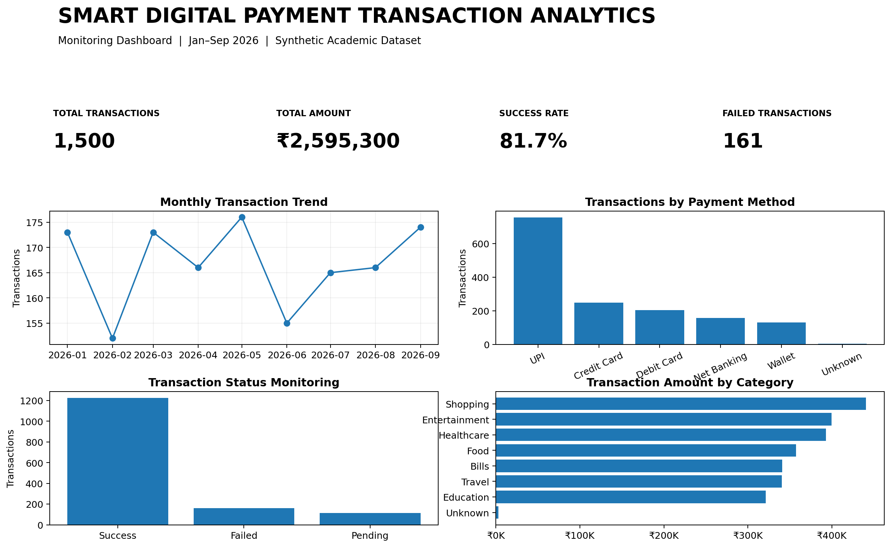

# Smart Transaction Data Analytics — Power BI

A college-ready analytics project inspired by the provided presentation **“Smart Digital Payment Transaction Analytics and Monitoring Dashboard.”** It demonstrates transaction data acquisition, data cleaning and transformation, payment-performance analysis, high-value anomaly monitoring, and interactive reporting in Power BI.

> **Dataset notice:** All transaction data in this repository is synthetic and created for academic demonstration. It is not real bank, payment-provider, or customer data. The high-value anomaly rule is a simple demo threshold, not a fraud-detection model or financial advice.

## Project highlights

- 1,508 raw rows including 8 duplicate transaction IDs; 1,500 unique transactions after deduplication.
- Excel workbook with `Transactions_Raw` and `Transactions_Clean` sheets, plus raw CSV.
- Power Query cleaning instructions and M-code starter.
- DAX measures for transaction volume, amounts, status rates, average amount, and high-value transactions.
- Dashboard preview and analyzed output workbook.
- Build instructions for recreating the interactive report in Power BI Desktop.

## Repository map

```text
Smart_Transaction_Data_Analytics_PowerBI/
├── data/
│   ├── Smart_Digital_Payment_Analytics_Dataset.xlsx
│   ├── Smart_Digital_Payment_Transactions_Raw.csv
│   ├── transactions_clean.csv
│   └── DATA_DICTIONARY.md
├── docs/
│   ├── PROJECT_REPORT.md
│   ├── POWER_BI_BUILD_STEPS.md
│   └── VIVA_QUESTIONS.md
├── outputs/
│   ├── Final_Dashboard_Results.xlsx
│   ├── Final_PowerBI_Style_Dashboard.png
│   └── Final_Project_Results.txt
├── powerbi/
│   ├── DAX_Measures.dax
│   ├── Power_Query_Cleaning.pq
│   └── README.md
├── references/
│   └── Original_Project_Presentation.pptx
└── visuals/
    └── system_architecture.png
```

## Quick start

1. Install [Microsoft Power BI Desktop](https://learn.microsoft.com/en-us/power-bi/fundamentals/desktop-get-the-desktop).
2. Open Power BI Desktop and select **Home → Get data → Excel**.
3. Choose `data/Smart_Digital_Payment_Analytics_Dataset.xlsx` and select `Transactions_Raw`.
4. Choose **Transform data** and follow `docs/POWER_BI_BUILD_STEPS.md` (or adapt `powerbi/Power_Query_Cleaning.pq` after changing the file path).
5. Create measures from `powerbi/DAX_Measures.dax`.
6. Build the recommended three pages: **Executive Dashboard**, **Payment Performance**, and **Anomaly Monitoring**.
7. Save the finished native Power BI report as `powerbi/Smart_Transaction_Data_Analytics_PowerBI.pbix`.

The `.pbix` is not included in this starter package because it must be authored and saved by Power BI Desktop. The preview PNG is a rendered design/result preview, not an interactive `.pbix` report.

## Results preview



The workbook `outputs/Final_Dashboard_Results.xlsx` includes KPI results, payment-method analysis, status analysis, monthly transaction trend, and high-value transactions.

## Main modules

1. **Transaction Data Acquisition** — loads transaction ID, amount, date/time, payment method and status.
2. **Data Cleaning & Transformation** — removes duplicate IDs, fills missing categorical values, and sets correct data types.
3. **Payment Performance Analytics** — measures transaction counts, amounts, success/failure/pending rates, and method/category trends.
4. **Anomaly Detection & Monitoring** — flags amounts above ₹25,000 for manual review.
5. **Interactive Visualization & Reporting** — KPIs, line/bar/donut charts, detail tables, and slicers.

## License / intended use

For learning and academic demonstration. Check institutional rules before using the included synthetic data and presentation materials in public submissions. The original presentation is included as a reference provided for this project.
