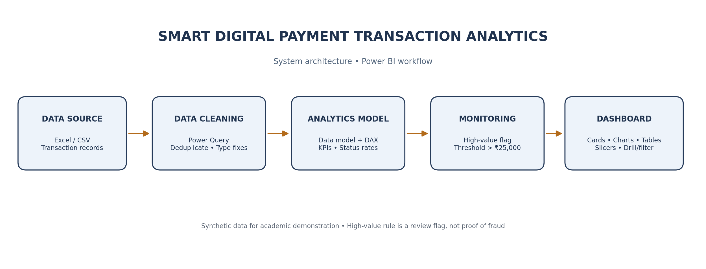

# Smart Digital Payment Transaction Analytics and Monitoring Dashboard

## Abstract

The Smart Digital Payment Transaction Analytics and Monitoring Dashboard is designed to analyze digital payment transactions through an interactive Power BI report. It uses transaction amount, date, time, payment method, transaction status, category, customer identifier, and location to summarize payment activity. Power Query is used to remove duplicate transaction records, handle missing categorical values, and assign suitable data types. DAX measures calculate transaction volume, total transaction amount, successful/failed/pending counts, success rate, average transaction value, and high-value transaction counts. Visuals and slicers make it easier to compare transaction trends and payment performance. A simple threshold-based monitoring page highlights high-value transactions for further review. The project uses synthetic academic data and demonstrates a centralized, visual, data-driven workflow.

## Introduction

Digital payment systems generate transaction records across payment methods, dates, locations, and statuses. Manually reviewing large transaction tables makes it difficult to identify changes in transaction volume, compare payment methods, and quickly locate failed or high-value transactions. This project uses Power BI to transform a structured transaction dataset into an interactive monitoring dashboard. Data preparation is handled through Power Query, calculations through DAX, and findings are presented through KPI cards, charts, tables, and slicers.

## Objectives

1. Analyze digital payment transaction data efficiently.
2. Monitor successful, failed, and pending transactions in one dashboard.
3. Visualize payment trends and performance by date, method, category, and location.
4. Highlight high-value transactions using an explainable threshold rule.
5. Support faster data-driven review through interactive visuals and filters.

## System architecture

**Data Source (CSV/Excel) → Power Query Data Cleaning → Data Model & DAX Analytics → Power BI Visualizations → Interactive Dashboard & Review**

## Modules

### 1. Transaction Data Acquisition

Loads transaction ID, amount, date/time, payment method, status, category, customer identifier, and location from the provided Excel/CSV dataset.

### 2. Data Cleaning and Transformation

Removes duplicate transaction IDs, replaces missing categorical values with `Unknown`, and converts date, time, and amount fields to suitable data types.

### 3. Payment Performance Analytics

Uses DAX measures to calculate total transactions, total transaction value, status counts, success/failure rates, average transaction amount, and group-level comparisons.

### 4. Anomaly Detection and Monitoring

Marks transactions above ₹25,000 as high-value items for review. This is a demonstrative rule only; it is not a validated fraud classifier and does not establish that a transaction is suspicious or fraudulent.

### 5. Interactive Visualization and Reporting

Presents information with KPI cards, monthly trend lines, payment-method charts, status comparisons, category/location views, transaction tables, and slicers.

## Dataset

The synthetic dataset covers January–September 2026. The raw file contains 1,508 rows because 8 duplicate transaction records and a small number of missing categorical values were intentionally included to demonstrate data cleaning. After deduplicating `Transaction_ID`, the analytic dataset contains 1,500 unique transactions.

## Results and discussion

After cleaning, the analytical data contains 1,500 unique transactions. The supplied output workbook contains calculated KPI, payment-method, transaction-status, monthly-trend, and anomaly summaries. The Power BI report is designed to let users inspect the results with slicers and cross-filtering. The high-value monitoring page uses the ₹25,000 threshold to bring selected records into a review table. The static dashboard preview is included as a visual guide; final interactive behavior is produced when the report is recreated and saved in Power BI Desktop.

> For numeric results calculated from the included data, refer to `../outputs/Final_Project_Results.txt` and `../outputs/Final_Dashboard_Results.xlsx`.

## Conclusion

The project demonstrates a full data analytics workflow for digital payment transactions: source-data acquisition, cleaning, measurement, anomaly flagging, visualization, and interactive exploration. Power BI provides a centralized view of transaction activity and makes comparisons by status, method, category, location, and date more accessible. The project can be extended with larger real-world datasets, role-level security, scheduled refresh, advanced statistical anomaly detection, and a secure approved payment data source.

## Limitations

- Synthetic data is used; results should not be interpreted as real payment-system performance.
- Anomaly detection is a fixed high-value threshold, not a machine-learning or financial-crime detection system.
- The included PNG is a static preview. A native `.pbix` must be authored in Power BI Desktop and is not generated automatically by this source package.
